# Mark's Mods

Table automation for **Pathfinder 2e** on **Foundry VTT v14**. Mark's Mods awards party XP
with a celebration on the map, aims Force Barrage before the cast, tracks Glimpse Weakness on its
target, and runs counteract checks straight from chat cards.

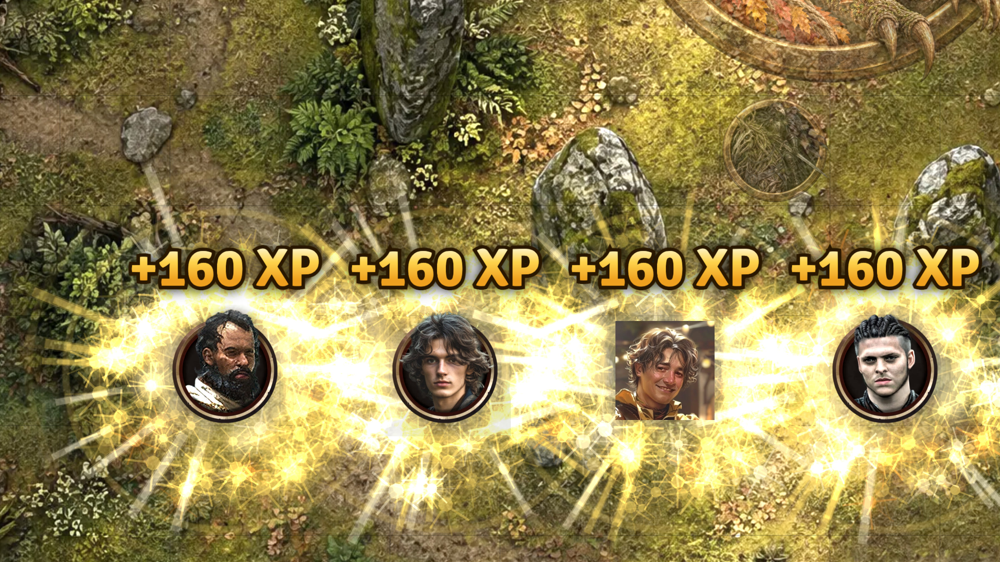

## Award Party XP

The GM picks an award from the GM Core presets for a four-character party, or types any amount,
and every party character gains it at once. A chat card names the recipients, and each
character's token celebrates on every connected client.

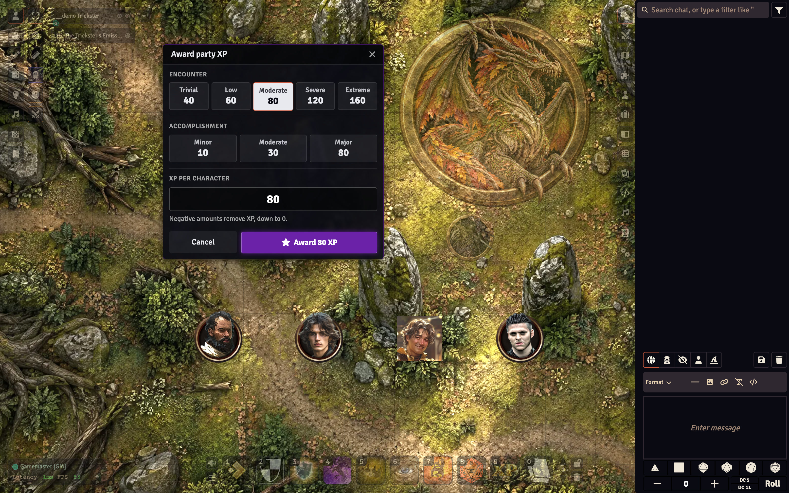

- Encounter presets from Trivial (40) to Extreme (160) and accomplishment presets from Minor
  (10) to Major (80).
- A negative amount removes XP, never below zero, and plays a red swirl.
- Ending a combat opens the window for the GM, preset to the XP PF2e calculates for that
  encounter. A world setting turns this off.
- Animal companions and other minions in the party gain no XP.
- The "Award Party XP" macro ships in the Mark's Mods Macros compendium, and scripts can call
  `game.modules.get('marks-mods').api.awardXp(amount, actors)`.

### Celebration sizes

The celebration grows with the award: a few sparkles for a small one, a shock wave and embers
for a moderate one, and fireworks for a large one.

| Small (40 XP) | Medium (80 XP) | Large (160 XP) |
|---|---|---|
| 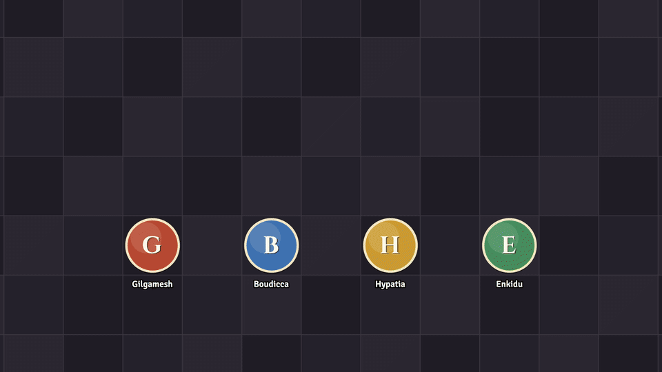 |  |  |

Full-quality video: [small](xp-award-small.mp4), [medium](xp-award-medium.mp4),
[large](xp-award-large.mp4), and [all three in a row](xp-award-all-tiers.mp4). Try each size in
the browser in the [XP Celebration Lab](https://claude.ai/artifact/EudiPysceY5UTQZdZ81sUh).

## Force Barrage

Casting Force Barrage opens a targeting window before PF2e spends the slot. Choose one, two or
three actions, spread the missiles across your targets, and press Fire. Closing the window
cancels the cast and spends nothing.

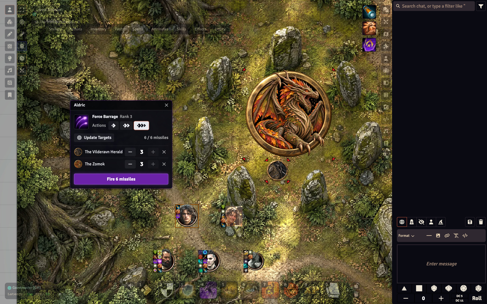

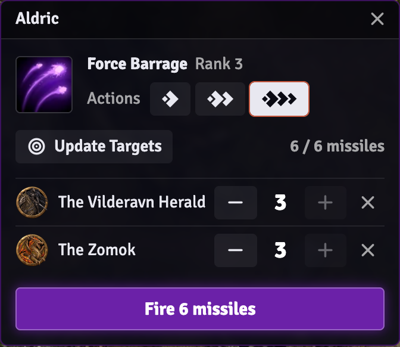

- The window counts missiles from the spell's rank and the actions you choose.
- Target tokens, then press **Update Targets** to share the missiles among them.
- Fire rolls the damage for each target in turn.

### Wand of Shardstorm

Activating a Wand of Shardstorm fires its first volley through the same window, then gives the
caster an effect for ten rounds. At the start of each of the caster's turns, the window opens
again for that turn's one-action volley.

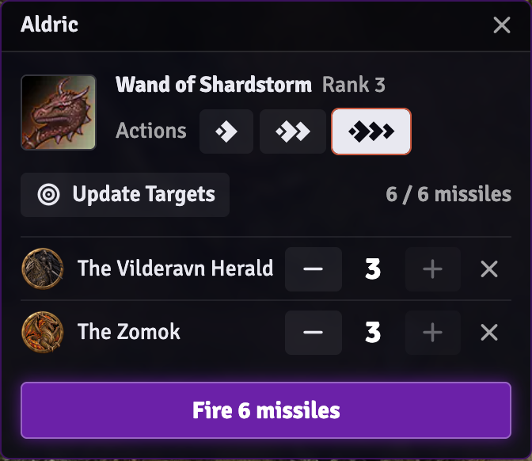

## Glimpse Weakness

Cast Glimpse Weakness with a creature targeted, and the module puts the spell's effect on that
creature. The effect states the precision damage for the cast's rank, amped or unamped. The
next Strike that hits the creature deals that damage and ends the effect. A second cast on the
same creature replaces the first.

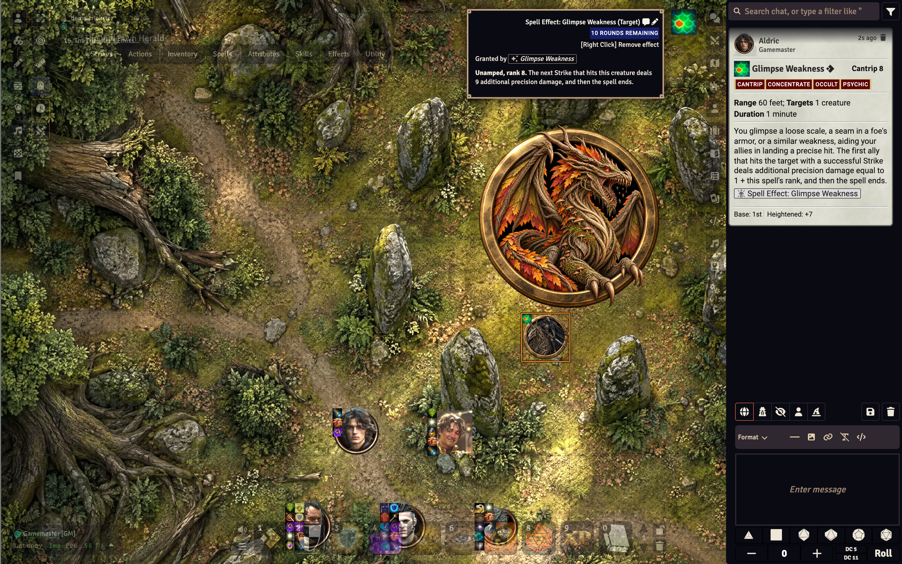

## Counteract from chat

Right-click any spell or effect card in chat and choose **Counteract**.

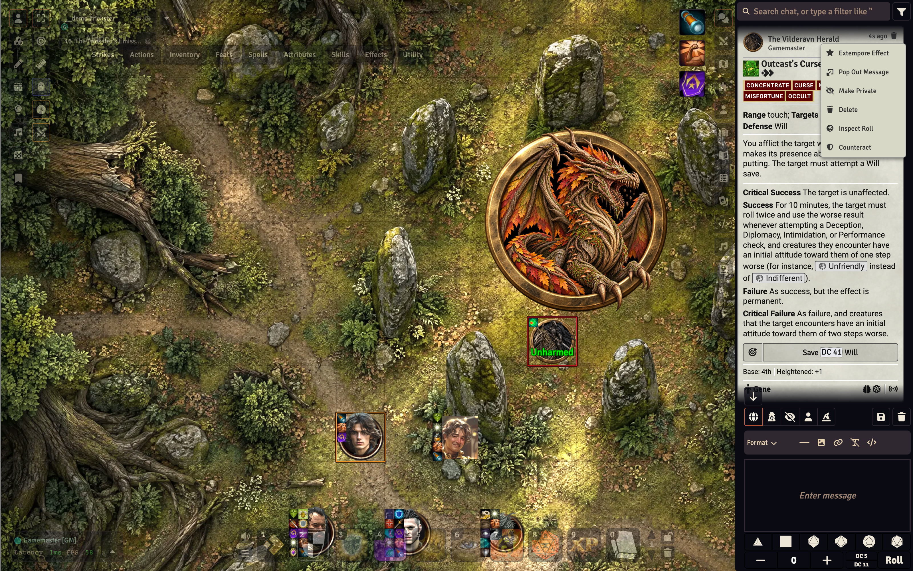

1. **Pick a source.** The player chooses a spell they can cast, at its rank, or a skill. **Show
   all spells** lists every castable spell.

   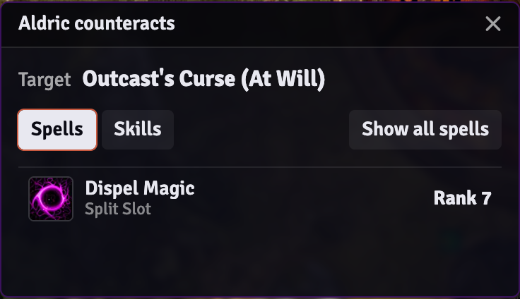
   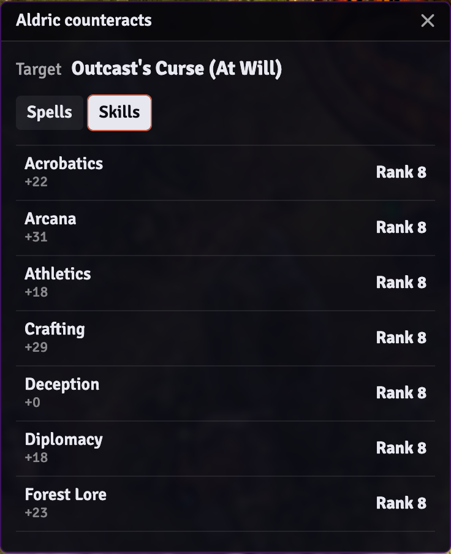

2. **GM review.** The GM sees the request with the target's counteract rank and DC filled in,
   each with the rule it came from. The GM adjusts either value, then approves or refuses.

   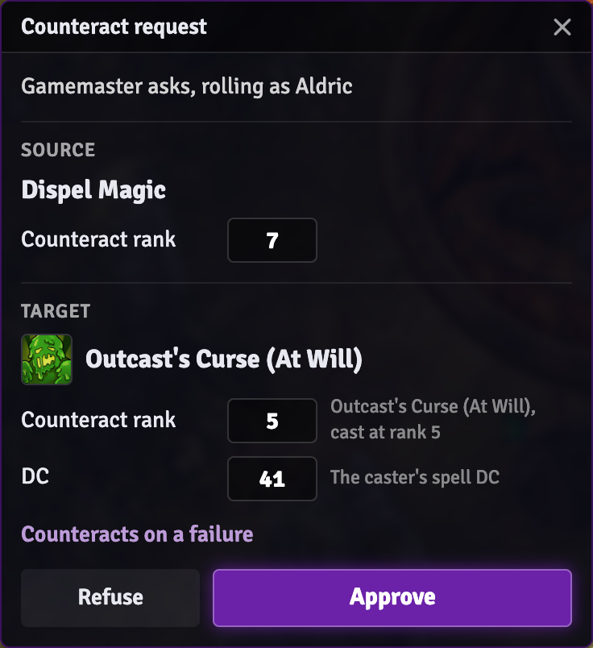

3. **Roll.** The player's client pays for the spell and rolls PF2e's counteract check against
   the approved DC. The roll card shows the highest rank each degree of success counteracts.

   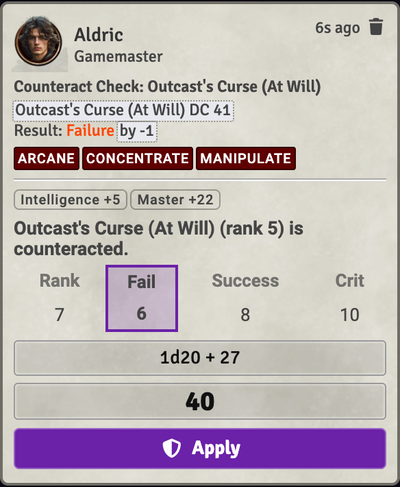

4. **Apply.** On a success, the GM presses **Apply**. When one effect came from the countered
   spell, Apply ends it at once. Otherwise the GM ticks the effects and conditions to end.
   **Undo** puts them back.

   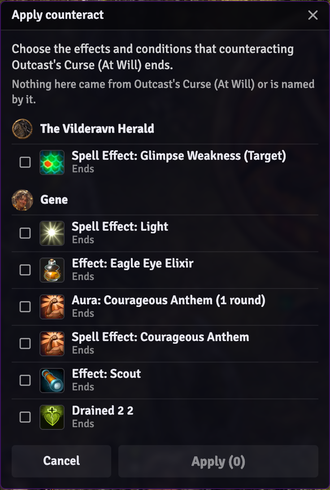
   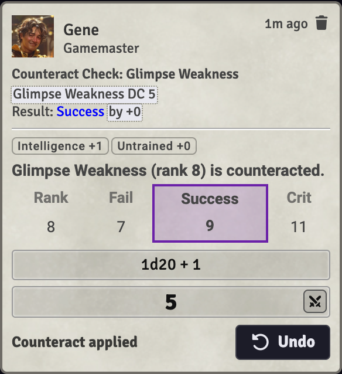

Hazards work too: the GM right-clicks the Disable section of a hazard's sheet to post a
counteract card with the hazard's rank and DC.

## Requirements

- Foundry VTT v14
- Pathfinder 2e system 8.0 or later

## Files in this folder

| File | Contents |
|---|---|
| `xp-award-{small,medium,large}.mp4` | 1920×1080, 60 fps celebration clips at 40, 80 and 160 XP |
| `xp-award-{small,medium,large}.gif` | The same clips at 960 px and 30 fps |
| `xp-award-all-tiers.mp4` | The three clips back to back |
| `xp-award-large-still.png` | A fireworks frame for a poster image |
| `screenshots/*.jpg` | Full-window Foundry captures |
| `screenshots/*.png` | Window and chat card close-ups at 2× scale |

The clips come from the XP Celebration Lab, which runs the module's own animation code on a mock
map. The screenshots come from a live Foundry v14 world running PF2e 8.6.1.
